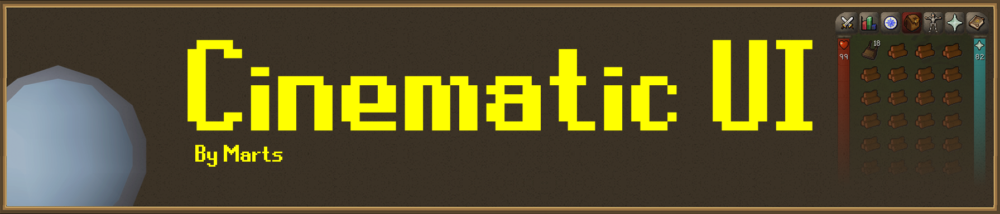
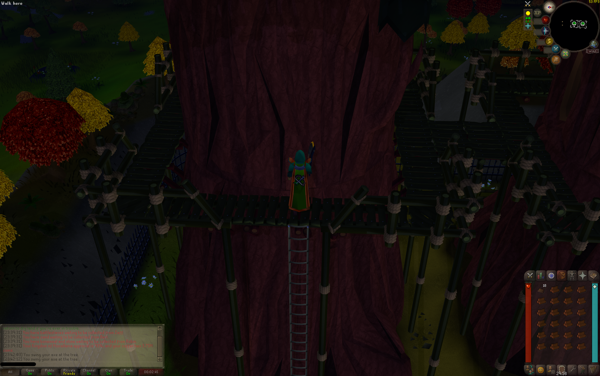
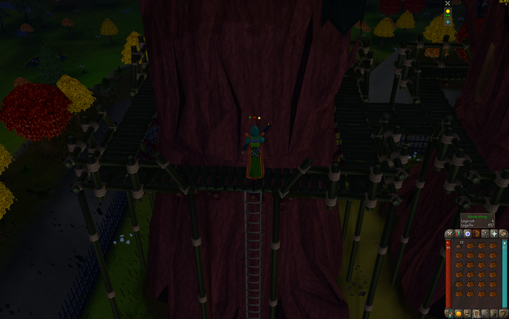
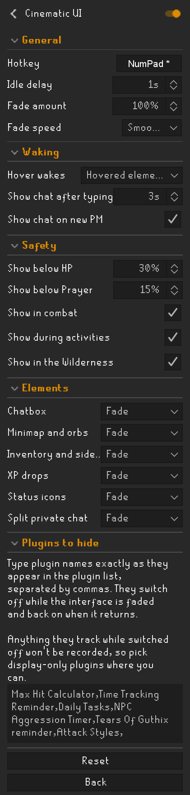

# Cinematic UI

Fade or hide the game interface after a delay of your choosing, or straight away with a hotkey, for a clean view of the game.

I made this plugin because I often have OSRS on my second monitor, and wanted to be able to hide the UI while I slowly whittle away at redwoods. So I made it customisable: you choose which parts of the interface fade, how far, how quickly and after how long, and it all comes back the moment you need it.

## Features

### Fading

- **Idle delay:** after this many seconds without moving the mouse or pressing a key, the interface fades. Set it to 0 to turn the timer off.
- **Hotkey:** fades the interface straight away, or brings it back. It starts unbound, so set one in the plugin's settings if you want it.
- **Fade amount:** how far the interface fades. Anything below 100% leaves it see-through and still clickable. At 100% it is hidden completely and can't be clicked.
- **Fade speed:** Instant, Fast or Smooth. Coming back is always twice as quick as fading away.

### Bringing it back

- **Click or keypress:** a click anywhere, or any keypress, brings everything back. Moving the mouse around the game world doesn't, so the interface stays faded while you watch.
- **Hover:** while faded, hovering over an element brings back just that element, or everything, depending on the **Hover wakes** setting. A single element fades again a second after you move off it.
- **Chat:** typing in chat shows the chatbox for a few seconds, and so can a new private message. Text left sitting in the chatbox doesn't keep it on screen.

### Elements

Each part of the interface can be set to **Fade** or **Always show**:

- Chatbox
- Minimap and orbs
- Inventory and side panel
- XP drops
- Status icons: the multicombat icon, Wilderness and PvP icons, buff bar and stat boosts
- Split private chat

### Always shown when you need it

The interface comes back on its own, and stays, in these situations:

- **Banking and trading:** the bank, deposit box, trade screens, Grand Exchange and shops
- **Dialogue:** NPC dialogue, level-up messages and the make-X menu. Input prompts in the chatbox, such as entering a quantity, bring back the chatbox
- **Combat:** while you're attacking an NPC, and for about 6 seconds after any hitsplat on you or from you
- **Activities:** while a minigame or activity display is on screen, such as raids, Wintertodt, Tempoross, Pest Control, Barrows or the God Wars kill count
- **Wilderness:** in the Wilderness and on PvP worlds
- **Low stats:** when your Hitpoints drop below a set percentage, or your Prayer does while a prayer is active

Combat, activities, Wilderness and low stats can each be turned off.

### Plugins to hide

Overlays from other RuneLite plugins, such as Time Tracking Reminder or a max hit calculator, can't be faded (see [Limitations](#limitations)). Instead, you can list plugins here by name, separated by commas, exactly as they appear in the plugin list. They are switched off once the interface has finished fading and switched back on as soon as it starts to return.

They're never marked as disabled in your settings, so if RuneLite closes while the interface is faded they still start as normal next time.

## Limitations

- **Resizable mode only.** Classic and modern resizable are both supported. In fixed mode the plugin leaves the interface alone.
- **Other plugins' overlays can't be faded.** RuneLite draws each plugin's overlay itself, and there's no way for one plugin to change another's. **Plugins to hide** works around this by switching them off instead, which has two costs:
  - **Missed tracking:** anything a plugin tracks while it's switched off isn't recorded, so stick to plugins that only display information. Avoid loot trackers, timers and session counters.
  - **Heavy plugins:** avoid heavy plugins such as GPU or 117 HD. Restarting them causes a noticeable stutter.
- **Hover areas while hidden.** When an element is hidden completely, its hover area is where it was last seen. If you resize the game window while it's hidden, hover over its old position, or click to bring everything back.
- **Activity displays.** Only activities with an on-screen display are detected. For example, the Fight Caves and Mahogany Homes have none, so they fade as normal unless you're in combat.
- **Minimap picture below 100%.** The map image and compass are drawn by the game client itself, so they can't be made see-through. Below 100% fade they stay solid while the frame around them fades. At 100% they hide as normal.
- **Never click-through.** A faded element always keeps its clicks, and only stops taking them once it's hidden completely, at which point it can't be used at all.

## Configuration

**General**

| Setting | Default | What it does |
| --- | --- | --- |
| Hotkey | Not set | Fades the interface straight away, or brings it back |
| Idle delay | 10 s | Seconds without mouse movement or a keypress before fading. 0 turns it off |
| Fade amount | 100% | How far elements fade. At 100% they are hidden and can't be clicked |
| Fade speed | Smooth | How quickly elements fade out and back in |

**Waking**

| Setting | Default | What it does |
| --- | --- | --- |
| Hover wakes | Hovered element | Whether hovering brings back just that element or everything |
| Show chat after typing | 3 s | How long the chatbox stays visible after you last typed |
| Show chat on new PM | On | Briefly shows the chat when you get a private message |

**Safety**

| Setting | Default | What it does |
| --- | --- | --- |
| Show below HP | 30% | Shows everything when your Hitpoints drop below this. 0 turns it off |
| Show below Prayer | 15% | Shows everything when your Prayer drops below this while a prayer is active. 0 turns it off |
| Show in combat | On | Never fades while you're in combat |
| Show during activities | On | Never fades while a minigame or activity display is on screen |
| Show in the Wilderness | On | Never fades in the Wilderness or on PvP worlds |

**Elements**

Chatbox, Minimap and orbs, Inventory and side panel, XP drops, Status icons and Split private chat. Each is Fade or Always show, and all default to Fade.

**Plugins to hide**

A comma-separated list of plugin names, empty by default.

## Issues and support

Found a bug or have an idea? Please [open an issue](../../issues/new) on GitHub. To help me fix a bug quickly, include:

- what you did, what you expected and what happened instead
- whether you use classic or modern resizable
- a screenshot if you can

You can also see [existing issues](../../issues) to check whether it's already been reported.

## License

[BSD 2-Clause](LICENSE). The banner's lettering uses the [RuneScape UF](https://www.dafont.com/runescape-uf.font) font by Nathan P (nayfan), licensed [CC BY-ND 3.0](https://creativecommons.org/licenses/by-nd/3.0/).
